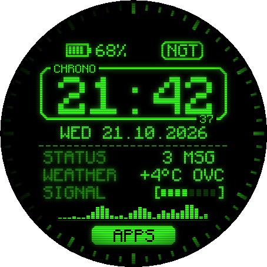
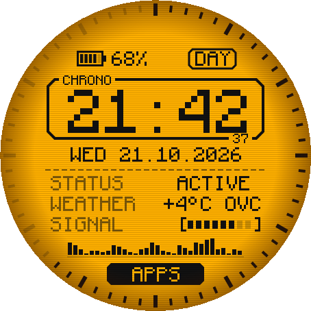
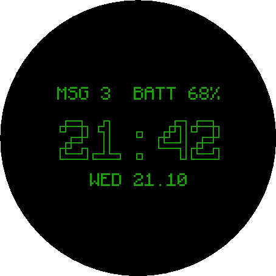
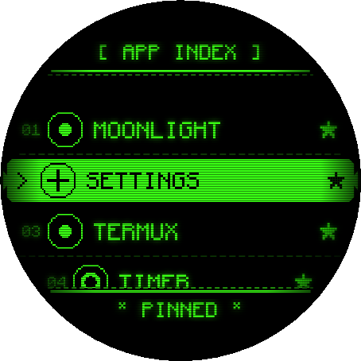
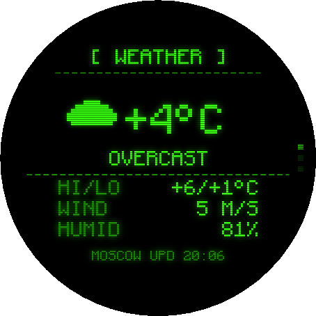
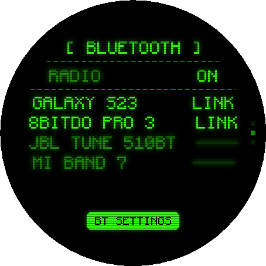
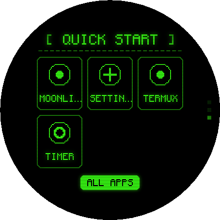

# RETRO-TERM

**A retro CRT-terminal watch face + launcher for Wear OS 2**

Amber phosphor by day, green phosphor by night: chunky pixel font, scanlines, glow and a seconds ring.
Built for the **TicWatch Pro 3 GPS** (454×454 round, Wear OS 2 / Android 9).


-orange)


| Watch face (night) | Watch face (day) | Always-on |
|:---:|:---:|:---:|
|  |  |  |

| App index | Weather | Bluetooth | Quick start |
|:---:|:---:|:---:|:---:|
|  |  |  |  |

> Looking for a DOS / Norton Commander look instead? See the sister project **[nc-watch](https://github.com/disp06/nc-watch)**.

---

## Features

- **Terminal watch face**: big pixel clock with a 60-segment seconds ring, battery cell, date, live telemetry
  rows (unread notifications, weather, Wi-Fi signal), a spectrum strip and an `APPS` key.
- **Day / Night / Auto themes**:
  - **DAY:** amber CRT, `#FFB000` background with `#111111` text
  - **NGT:** green phosphor, `#39FF14` on black, with glow
  - **AUT:** day from 07:00 to 19:59, night otherwise
- **System gestures keep working.** RETRO-TERM is a *watch face*, not a home replacement, so Tiles,
  notifications and quick settings behave as usual.
- **App index**: terminal-style list of every app. The centred row gets an inverted `> NAME` selector bar, rows
  follow the round edge of the screen, and each icon is converted to a 1-bit 24×24 pixel sprite.
- **Favorites**: long-press an app to pin it to the top with a pixel ★. Pinned apps also appear on the
  Quick Start page.
- **RETRO-INFO screen**, three snap-scrolled pages:
  - **WEATHER:** temperature, conditions, high/low, wind, humidity
  - **BLUETOOTH:** radio state, paired devices, `LINK` / `----` connection status
  - **QUICK START:** up to 6 pinned apps as big buttons
- **Always-on mode**: dim, outline-only clock that shifts a few pixels every minute (burn-in protection).
- **Lightweight**: everything is drawn straight to a canvas on a 454×454 design grid. Font sizes are exact
  multiples of the font's pixel grid, so every font pixel lands on whole screen pixels.

## Controls

| Where | Action | Result |
|---|---|---|
| Watch face | tap the top row (battery / mode key) | cycle **AUT → DAY → NGT** |
| Watch face | tap the middle (clock / telemetry) | open **RETRO-INFO** |
| Watch face | tap **APPS** | open the **App index** |
| Watch face | swipe left / up / down | Tiles / notifications / quick settings (system) |
| App index | tap | launch |
| App index | long-press | pin / unpin (★) |
| Any screen | swipe right | back to the watch face |
| RETRO-INFO | scroll up / down | switch page |
| RETRO-INFO | tap the weather page | refresh weather |

> **Tip:** RETRO-TERM and RETRO-INFO also appear as normal apps, so you can put either on the bottom hardware
> button: *Settings → Personalization → Customize hardware buttons*.

## Install

Download the APK from **[Releases](https://github.com/disp06/retro-term/releases/latest)** and sideload it with ADB
(a cable or ADB over Wi-Fi both work):

```bash
adb connect <watch-ip>:5555
adb install -r RetroTerm-2.0.1.apk
```

Then **long-press the current watch face → scroll → RETRO-TERM** (or choose it in the Wear OS phone app).

## Build from source

Requirements: JDK 17+ and the Android SDK (platform 34).

```bash
git clone https://github.com/disp06/retro-term.git
cd retro-term
./gradlew assembleRelease        # Windows: gradlew.bat assembleRelease
```

Output: `app/build/outputs/apk/release/app-release.apk`. The release build is signed with the debug key so it can
be sideloaded directly. Every push is also built by GitHub Actions (see the *Actions* tab).

## Project structure

```
app/src/main/java/com/disp06/retroterm/
├── face/RetroWatchFace.kt     CanvasWatchFaceService: ticker, ambient, unread count, tap zones
├── ui/TerminalRenderer.kt     the terminal clock screen
├── ui/AppRowView.kt           app list row (round-edge inset, selector bar, ★)
├── ui/InfoPageView.kt         WEATHER / BLUETOOTH / QUICK START pages
├── ui/CrtOverlayView.kt       scanlines + vignette
├── AppListActivity.kt         app index
├── InfoActivity.kt            RETRO-INFO pager
├── AppRepository.kt           app loading + 1-bit icon pixelizer
├── Favorites.kt               pinned apps
├── WeatherRepo.kt             location + Open-Meteo + cache
├── BtInfo.kt                  paired Bluetooth devices
├── Telemetry.kt               battery / Wi-Fi / decorative data
└── ThemePrefs.kt              AUTO / DAY / NIGHT
```

## Permissions & privacy

| Permission | Why |
|---|---|
| `WAKE_LOCK`, `PROVIDE_BACKGROUND` | required for a watch face |
| `ACCESS_WIFI_STATE` | Wi-Fi signal bars |
| `BLUETOOTH` | paired device list on the Bluetooth page |
| `INTERNET` | weather |
| `ACCESS_COARSE/FINE_LOCATION` | weather for your location (optional) |
| `VIBRATE` | haptic tick on taps |

Weather comes from [Open-Meteo](https://open-meteo.com) (free, no API key) over the phone connection. If location
permission is denied, an approximate location is taken from your IP address via [ipwho.is](https://ipwho.is).
No analytics, no accounts. Settings stay on the watch.

## Limitations

- **Wear OS 2 only.** It uses the legacy `CanvasWatchFaceService` API (Android 8–9 watches).
- **Swipe right** from the watch face belongs to the system (Assistant) and can't be overridden by a watch face.
  That's why RETRO-INFO opens with a tap.
- COMM LINK frequency and the spectrum strip are decorative.

## Credits

- Font: **[Monocraft](https://github.com/IdreesInc/Monocraft)** by Idrees Hassan, SIL Open Font License 1.1
  (see [`licenses/`](licenses/))
- Weather data: [Open-Meteo](https://open-meteo.com) (CC BY 4.0)

## License

Code: [MIT](LICENSE). Bundled fonts keep their own licences (see [`licenses/`](licenses/)).
